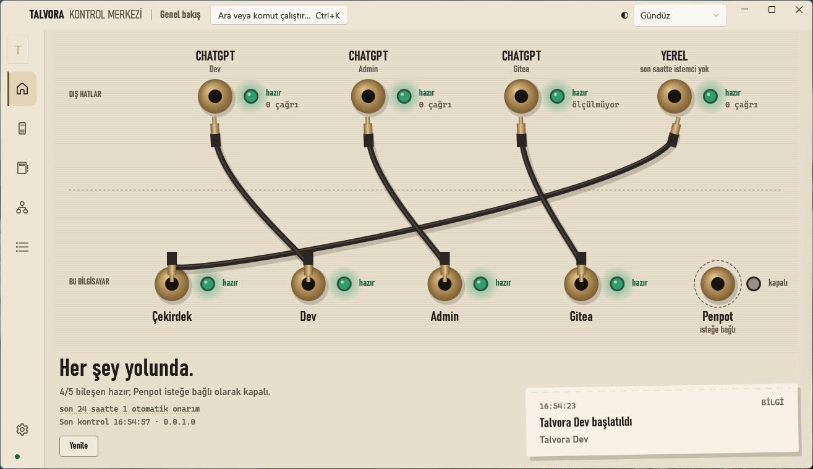
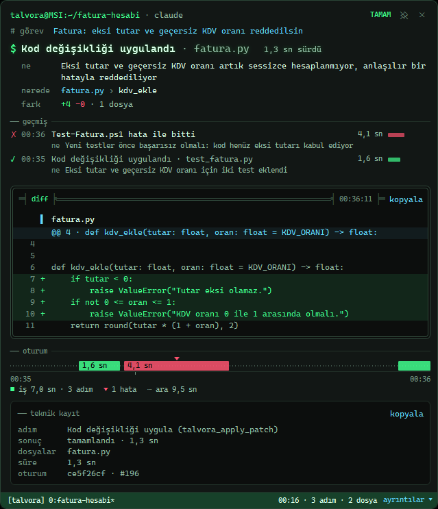
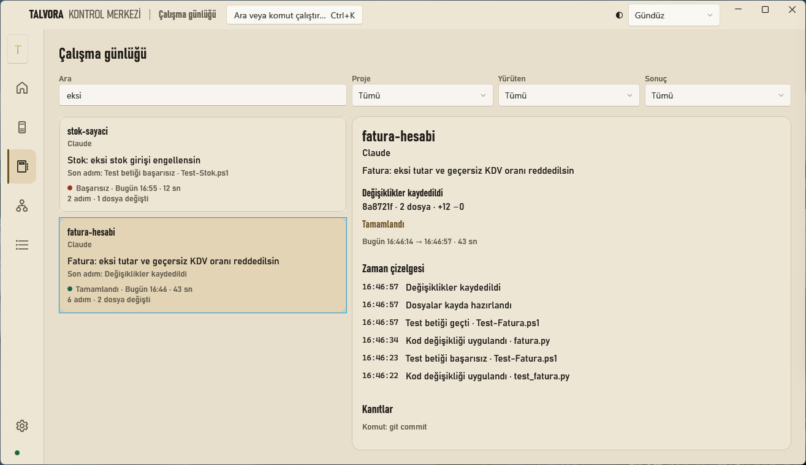

<p align="center">
  
</p>

<h1 align="center">Talvora</h1>

<p align="center">Yapay zekâ ajanlarına Windows bilgisayarında gerçek bir çalışma masası açan yerel MCP hizmeti.</p>

<picture>
  <source media="(prefers-color-scheme: dark)" srcset="docs/media/kontrol-merkezi-gece.png">
  
</picture>

Merhaba, ben Taylan. Talvora'yı kendi bilgisayarım için yazdım. ChatGPT, Claude ve Codex Windows'ta bir geliştirici gibi çalışabilsin istedim: kodu okusun, değiştirsin, derlesin, testleri koşsun, takılan bir hizmete bakıp düzeltsin. Ben de bütün bunları ekrandan izleyebileyim.

Talvora arka planda bir Windows hizmeti olarak çalışır ve bu istemcilere MCP üzerinden araçlar sunar. Görev çubuğundaki Kontrol Merkezi her şeyin yolunda olup olmadığını gösterir. Yukarıdaki ekranda üst sıra bağlanan istemciler, alt sıra bu bilgisayardaki bileşenler; ışıklar ve sayılar gerçek ölçümlerden gelir.

## Neler yapabiliyor

Ajan bir dosyayı önce okur, değişikliği sonra tek seferde yazar. Dosya o arada başka biri tarafından değiştirildiyse Talvora değişikliği yazmaz, yarım kalan bir yazma da geri alınır; senin elle yaptığın bir değişiklik ezilmez.

Derleme ve testler senin hesabınla, senin araçlarınla çalışır: .NET, Node.js, Python, Rust, Go, Java ve Android. Ortaya çıkan dosyalar da senin olur. Hizmetler, olay günlüğü, kayıt defteri ve paketler gibi Windows işlerini de yönetir; uzun süren görevleri ve geliştirme sunucularını başlatıp izler, Git ve GitHub ile çalışır.

Bir şey bozulursa Kontrol Merkezi bozulan parçayı bulur, önce en küçük onarımı dener ve o parça gerçekten hazır olmadan "düzeldi" demez.

## Bir ajan çalışırken

<p align="center">
  
</p>

En çok kullandığım parça bu kart. Bir ajan çalışmaya başlayınca masaüstünün köşesinde açılır: üstte görev, altında ajanın kendi cümlesiyle ne yaptığı, ortada değişikliğin kendisi. Oturum bitince her şey Kontrol Merkezi'ndeki Çalışma günlüğü'nde kalır; bir adımın neden başarısız olduğuna sonradan da bakabilirsin.



## Kurulum

En yeni kurulum dosyası [Releases](https://github.com/bingoweb/Talvora-MCP/releases/latest) sayfasında. İndirip çalıştırman yeterli: kurulum yönetici izni ister, hizmeti ve Kontrol Merkezi'ni yerleştirir, PowerShell 7 yoksa onu da kurar. Windows 10 ya da 11 (64 bit) gerekir.

Kurulum dosyası henüz imzalı değil, bu yüzden Windows ilk açılışta uyarabilir: **Ek bilgi**'ye, sonra **Yine de çalıştır**'a bas. Dosyanın değişmediğinden emin olmak istersen SHA-256 değerini aynı sayfadaki `SHA256SUMS.txt` ile karşılaştırabilirsin:

```powershell
Get-FileHash .\Talvora-Kurulum-*.exe -Algorithm SHA256
```

Kaldırmak için Windows Ayarları'ndaki uygulama listesinden Talvora'yı kaldırman yeterli. Kontrol Merkezi'nden sonradan kurduğun Gitea ve ChatGPT tüneli bu kaldırmaya dahil değil.

Yeni sürümler doğrulandıkça aynı sayfaya gelir, her birinin Türkçe notu orada. Kontrol Merkezi günde bir kez yeni sürüm var mı diye bakar ve varsa haber verir; kendiliğinden bir şey indirip kurmaz.

Kodu kendin derleyip kurmak istersen PowerShell 7, [global.json](global.json) dosyasındaki .NET SDK sürümü ve Chocolatey gerekir. Yönetici olarak açtığın bir terminalde:

```powershell
git clone https://github.com/bingoweb/Talvora-MCP.git
cd Talvora-MCP
.\TALVORA-KUR.cmd
```

## İstemcileri bağlamak

Talvora yalnızca bu bilgisayardan, `http://127.0.0.1:7676` adresinden dinler. `/mcp` bütün araçları, `/mcp/dev` geliştirme araçlarını (kod, derleme, Git), `/mcp/admin` yönetim araçlarını (hizmetler, kayıt defteri, paketler) açar.

- **Codex:** Kurulum, Talvora'yı Codex'e kendiliğinden tanıtır.
- **Claude Code:** `claude mcp add --transport http talvora http://127.0.0.1:7676/mcp/dev`
- **ChatGPT:** ChatGPT Business kullanıyorsan Kontrol Merkezi → Ayarlar ve kurulum'daki sihirbaz OpenAI'nin güvenli MCP tünelini kurar; Talvora Dev ve Talvora Admin, ChatGPT'de bağlayıcı olarak görünür. Yerel adres internete açılmaz. Sihirbaz bir OpenAI Admin API anahtarı ister.

## Kurmadan önce bil

Talvora, Windows'un en yetkili hesabı olan LocalSystem ile çalışır. Ona bağladığın bir ajan bu bilgisayarda dosya silmekten bir hizmeti durdurmaya kadar neredeyse her şeyi yapabilir. Bunu bilerek böyle tasarladım; o yüzden Talvora'yı yalnızca kendi bilgisayarına kur ve yalnızca güvendiğin istemcileri bağla. Ağdaki başka bir bilgisayar ya da tarayıcıda açtığın bir site ona ulaşamaz, ama yerel bir parolası da yok: bu bilgisayarda çalışan her program bağlanabilir. Ayrıntılar [SECURITY.md](SECURITY.md) dosyasında.

## Lisans

Kendi kodum MIT lisanslı: [LICENSE](LICENSE). Kullandığım üçüncü taraf yazılımlar kendi lisanslarıyla gelir; kilitli NuGet paketlerinin ve eşlik eden araçların listesi [THIRD-PARTY-NOTICES.md](THIRD-PARTY-NOTICES.md) dosyasında. Kodun nasıl kurulduğunu merak edersen [docs/ARCHITECTURE.md](docs/ARCHITECTURE.md) iyi bir başlangıç.

---

### In English

I wrote Talvora for my own Windows machine. It runs as a Windows service and gives ChatGPT, Claude Code and Codex tools for real development work: careful source edits, builds and tests under your own account, Windows administration and Git. A Control Center shows its health, and a small desktop card shows what an agent is doing while it works. The interface is in Turkish. Talvora runs with LocalSystem rights and listens on 127.0.0.1 only, so install it on your own development machine and connect only clients you trust. The installer is on the [Releases](https://github.com/bingoweb/Talvora-MCP/releases/latest) page; it is not signed yet, so Windows SmartScreen may ask you to confirm. The code is MIT licensed.
