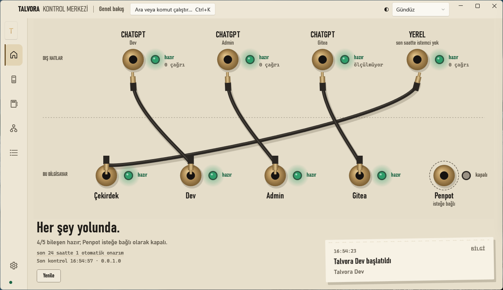
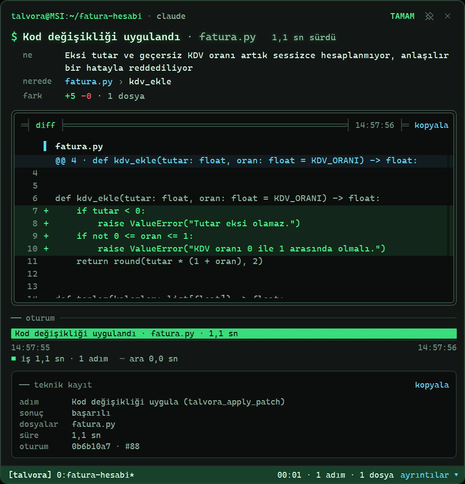
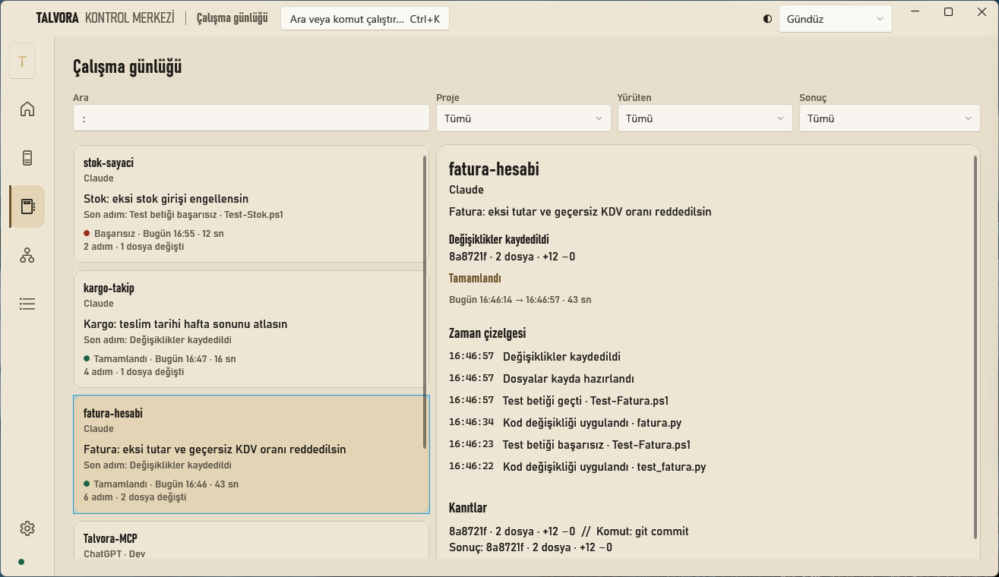

<p align="center">
  
</p>

<h1 align="center">Talvora</h1>

<p align="center">Yapay zekâ ajanlarına Windows bilgisayarında gerçek bir çalışma masası açan yerel MCP hizmeti.</p>

<picture>
  <source media="(prefers-color-scheme: dark)" srcset="docs/media/kontrol-merkezi-gece.png">
  
</picture>

Merhaba, ben Taylan. Talvora'yı kendi bilgisayarım için yazdım. ChatGPT'nin, Claude'un ve Codex'in Windows'ta bir geliştirici gibi çalışmasını istiyordum: kodu okusun, değiştirsin, derlesin, testleri koşsun, bir hizmet takılınca bakıp düzeltsin. Bunları yaparken ne olup bittiğini de ekrandan izleyebileyim.

Talvora arka planda bir Windows hizmeti olarak çalışır ve bu istemcilere MCP üzerinden araçlar sunar. Görev çubuğundaki Kontrol Merkezi her şeyin yolunda olup olmadığını gösterir. Yukarıdaki santralde üst sıra bağlanan istemciler, alt sıra bu bilgisayardaki bileşenler; ışıklar ve sayılar uydurma değil, gerçek ölçümlerden gelir. Bir ajan çalışırken masaüstünün köşesinde küçük bir kart açılır ve o an ne yaptığını satır satır anlatır.

## Neler yapabiliyor

**Kodu güvenle değiştirir.** Ajan bir dosyayı önce okur, sonra değişikliği tek parça hâlinde yazar. Dosya bu arada başka biri tarafından değiştirildiyse değişiklik reddedilir; yarım kalan bir yazma kendiliğinden geri alınır. C# için sembol düzeyinde yeniden adlandırma, tekrar eden büyük düzenlemeler için de söz dizimi ağacı üzerinden toplu düzenleme var.

**Senin araçlarınla derler ve test eder.** .NET, Node.js, Python (uv ile), Rust (cargo ile), Go, Java, Flutter ve Android araçları oturum açmış kullanıcı olarak, senin PATH'inle ve senin ayarlarınla çalışır. Ortaya çıkan dosyalar da senin olur.

**Windows'u yönetir.** Hizmetler, olay günlüğü, kayıt defteri, ortam değişkenleri, Chocolatey paketleri, ağ ve TLS denetimleri. Uzun süren işleri ve geliştirme sunucularını başlatır, izler, durdurur.

**Git ve GitHub ile çalışır.** Durum, fark ve geçmişe bakar; gönderme ve çekme senin kimlik bilgilerinle olur.

**Kendini izler ve onarır.** Kontrol Merkezi bozulan katmanı bulur, önce en küçük onarımı dener ve bileşen yeniden hazır olmadan "düzeldi" demez.

## Bir ajan çalışırken

<p align="center">
  
</p>

Talvora'da en çok kullandığım parça bu kart. En üstte ajanın üzerinde çalıştığı görev, altında kendi cümlesiyle ne yaptığı ve nerede yaptığı yazar; ortada değişikliğin gerçek farkı durur, alttaki şerit de oturumun zamanını ölçtüğü kadarıyla gösterir. Oturum bitince her şey Kontrol Merkezi'ndeki Çalışma günlüğü'nde kalır; hangi projede kimin ne yaptığını, bir adım neden başarısız olduğunu sonradan da açıp bakabilirsin.



## Kurulum

En son sürümün kurulum dosyası [Releases](https://github.com/bingoweb/Talvora-MCP/releases/latest) sayfasında: şu an `Talvora-Kurulum-0.0.1.0.exe`. İndirip çalıştırman yeterli. Kurulum yönetici izni ister, Windows hizmetini, Kontrol Merkezi'ni ve Başlat menüsü kısayolunu yerleştirir; PowerShell 7 yoksa Microsoft'un resmi paketini indirip doğrulayarak onu da kurar. Gerekenler: Windows 10 ya da 11 (64 bit) ve yönetici yetkisi. Program dosyaları `C:\Program Files\Talvora` altına, kayıtlar ve ayarlar `C:\ProgramData\Talvora` altına gider; her şey yolundaysa `http://127.0.0.1:7676/healthz` adresi çalışan sürümü gösterir.

Kurulum dosyası henüz imzalı değil. Windows bu yüzden ilk açılışta bir uyarı gösterebilir: **Ek bilgi**'ye, sonra **Yine de çalıştır**'a bas. İstersen önce dosyanın SHA-256 değerini aynı sayfadaki `SHA256SUMS.txt` ile karşılaştır:

```powershell
Get-FileHash .\Talvora-Kurulum-0.0.1.0.exe -Algorithm SHA256
```

Kaldırmak için Windows Ayarları'ndaki yüklü uygulamalar listesinde Talvora'yı seçip kaldır. Kontrol Merkezi'nden sonradan kurduğun ek bileşenler (Gitea, Penpot, ChatGPT tüneli) bu kaldırmaya dahil değildir.

### Kaynaktan kurmak

Kodu değiştirmek istersen Talvora'yı kaynaktan da kurabilirsin. Bunun için ayrıca PowerShell 7, [global.json](global.json) dosyasındaki .NET SDK sürümü ve Chocolatey gerekir. Yönetici olarak açtığın bir terminalde:

```powershell
git clone https://github.com/bingoweb/Talvora-MCP.git
cd Talvora-MCP
.\TALVORA-KUR.cmd
```

Bu yol da hizmeti ve Kontrol Merkezi'ni yerleştirir, ardından kurulan sürümü uçtan uca dener.

## İstemcileri bağlamak

Talvora yalnızca bu bilgisayarın içinden, `http://127.0.0.1:7676` adresinden dinler ve üç kapı açar:

| Adres | Ne için |
| --- | --- |
| `/mcp` | bütün araçlar |
| `/mcp/dev` | geliştirme: kod, derleme, Git, işler |
| `/mcp/admin` | yönetim: hizmetler, kayıt defteri, ortam, paketler |

Şu an **250 araç** var: geliştirme yüzeyinde **213**, yönetim yüzeyinde **88**; **51** araç ikisinde ortak.

- **Codex:** Kurulum, Talvora'yı Codex'e temel araçlarıyla kendiliğinden tanıtır.
- **Claude Code:** `claude mcp add --transport http talvora http://127.0.0.1:7676/mcp/dev`
- **ChatGPT:** ChatGPT Business kullanıyorsan Kontrol Merkezi → Ayarlar ve kurulum'daki sihirbaz OpenAI'nin güvenli MCP tünelini kurar; Talvora Dev ve Talvora Admin, ChatGPT'de bağlayıcı olarak görünür. Yerel adres internete açılmaz. Sihirbaz bir OpenAI Admin API anahtarı ister.
- MCP'yi HTTP üzerinden konuşan başka bir istemci de aynı adreslere bağlanabilir.

## Kurmadan önce bil

Talvora, Windows'un en yetkili hesabı olan LocalSystem ile çalışır. Ona bağladığın bir ajan bu bilgisayarda dosya silmekten bir hizmeti durdurmaya, kayıt defterini değiştirmeye kadar neredeyse her şeyi yapabilir. Bunu bilerek böyle tasarladım; ama bu yüzden Talvora'yı yalnızca kendi geliştirme bilgisayarına kur ve yalnızca güvendiğin istemcileri bağla.

- Hizmet yalnızca `127.0.0.1` adresini dinler. Ağdaki başka bir bilgisayar ona ulaşamaz, tarayıcıda açtığın bir site de onu çağıramaz.
- Yerel bir parola yok: bu bilgisayarda çalışan her program bağlanabilir.
- Günlüklerde parolalar, anahtarlar ve erişim jetonları maskelenir.

Ayrıntılar [SECURITY.md](SECURITY.md) dosyasında.

## Sürümler

Sürüm numaraları `0.0.x.x` biçiminde. Üçüncü sayı yeni bir yetenek geldiğinde artar, dördüncü sayı yalnızca düzeltme, metin ya da güncelleme olduğunda. Sürümleri biriktirerek çıkarıyorum: kullanıcıya görünen değişiklikler doğrulandıkça bir sonraki denetimde yeni sürüm gelir. Güvenlik ya da çökme düzeltmeleri denetimi beklemez, hemen düzeltme sürümü olarak çıkar. Bir sürümü ancak bütün denetimler, GitHub'daki derleme ve o sürümün kendi kurulum dosyasıyla yapılan uçtan uca test geçtikten sonra yayımlıyorum. Her sürümün notu [Releases](https://github.com/bingoweb/Talvora-MCP/releases) sayfasında; Türkçe, sonunda kısa bir İngilizce özetle. Kontrol Merkezi günde bir kez yeni sürüm olup olmadığına bakar; varsa Ayarlar simgesinin köşesinde küçük bir noktayla haber verir, kendiliğinden hiçbir şey indirmez ya da kurmaz.

## Kaynak koda bakmak isteyenler için

| Klasör | İçinde ne var |
| --- | --- |
| `src/Talvora` | hizmet ve MCP araçları |
| `src/Talvora.Shared` | ortak sözleşmeler, araç listesi, süreç çalıştırıcıları |
| `src/Talvora.Tray` | görev çubuğu simgesi, Kontrol Merkezi ve çalışma kartı |
| `src/Talvora.Installer` | kurulum programı |
| `tests` | duman testleri ve gerileme testleri |
| `docs` | mimari ve geliştirme ortamı notları |

Her değişiklik `pwsh -NoProfile -File scripts/Invoke-QualityGate.ps1` kapısından geçer: kilitli paket geri yükleme, derleme, davranış testleri, kurulu hizmet üzerinde canlı denetimler ve masaüstü testi. Mimarinin ayrıntısı [docs/ARCHITECTURE.md](docs/ARCHITECTURE.md), geliştirme ortamı [docs/DEVELOPMENT-ENVIRONMENT.md](docs/DEVELOPMENT-ENVIRONMENT.md) dosyasında.

## Lisans ve üçüncü taraf yazılımlar

Kendi kodum MIT lisansıyla açık: [LICENSE](LICENSE). Talvora'nın kullandığı üçüncü taraf yazılımlar kendi lisanslarıyla gelir; kilitli NuGet paketlerinin, .NET çalışma zamanı paketlerinin ve eşlik eden araçların tam listesi [THIRD-PARTY-NOTICES.md](THIRD-PARTY-NOTICES.md) dosyasında.

---

### In English

Talvora is a local MCP server for Windows. It runs as a Windows service and gives AI clients such as ChatGPT, Claude Code and Codex a set of structured tools for real development work: transactional source edits, builds and tests that run as the signed-in user, Windows administration, Git, background jobs and dev servers. A desktop Control Center shows its health, and a small card shows what an agent is doing while it works. The interface is in Turkish. Talvora runs with LocalSystem rights and listens on 127.0.0.1 only, so install it on your own development machine. Download the installer from [Releases](https://github.com/bingoweb/Talvora-MCP/releases/latest) (currently `Talvora-Kurulum-0.0.1.0.exe`); it is not signed yet, so Windows SmartScreen may ask you to confirm. Versions are `0.0.feature.fix`, released in batches once the changes are verified (security and crash fixes at once), each with Turkish notes and a short English summary; the Control Center checks for a new release once a day and never installs anything by itself. The code is MIT licensed.
